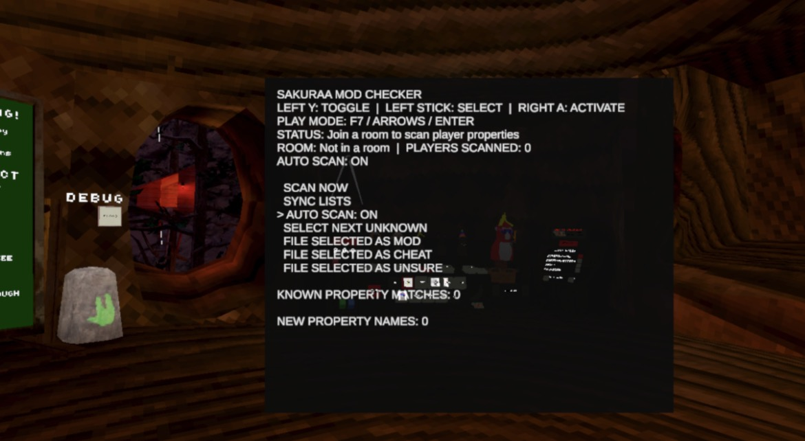
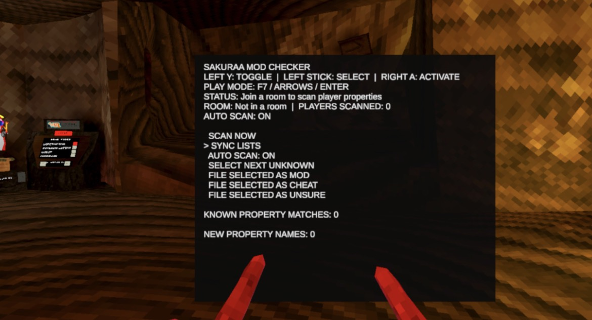

# 🛡️ GTAG Mod Checker

A Quest-based mod checker for **Gorilla Tag** that helps identify players who may be using mods, cheats, or other unfair modifications.

## 📱 About

**Mod Checker** is an Android APK designed for Meta Quest users. It aims to help identify suspicious activity in Gorilla Tag, making it easier to spot potential cheaters and mod users.

## ✨ Features

- 🔍 **Mod Detection** – Helps identify potential mod users.
- 🚨 **Cheat Detection** – Flags suspicious behavior that may indicate cheating.
- 🎮 **Quest Support** – Designed for Android-based Meta Quest headsets.
- ⚡ **Easy to Use** – Simple and straightforward interface.
- 🛡️ **Player Checking** – Helps users investigate potentially unfair gameplay.

## 📥 Installation

1. Download the latest Version.
2. Extract the .zip file.
3. Install the Mod Checker APK.

## 📸 Screenshots

Add your own screenshots below!

| Main Menu | Mod Checker |
|:---:|:---:|
|  |  |

## ⚠️ Disclaimer

- This project is an independent community tool.
- It is not affiliated with, endorsed by, or supported by Another Axiom.
- Detection results may not always be accurate.
- A flagged player is not necessarily cheating.
- Do not use this tool to harass, falsely accuse, or target other players.

## 🔧 Compatibility

- **Platform:** Meta Quest
- **File format:** APK
- **Game:** Gorilla Tag

## 📋 Updates

Check the [Releases](recrewind/mod-checker/releases) page for the latest versions and updates.

## ⭐ Support

[Discord](https://discord.gg/questmods)
Support Me @ [Ko-Fi](https://ko-fi.com/nkhhi)

---

**Made for the Gorilla Tag community.** 🦍
